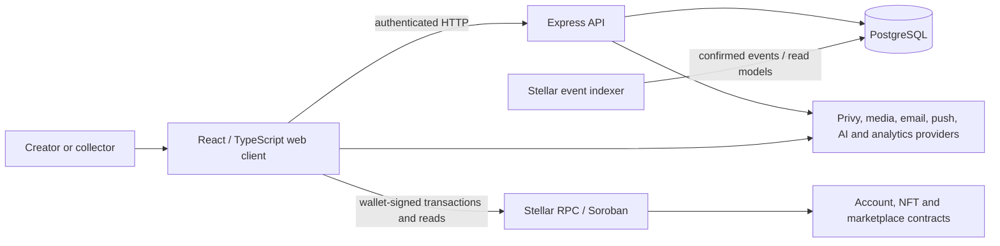

# NovaMarket: Technical Architecture

**Status:** Repository-based architecture reference · **Network target:** Stellar Testnet

## System context

## Components

| Component | Responsibility | Source location |
| --- | --- | --- |
| Web client | Feed, profiles, studios, collections, marketplace, commerce and wallet interactions | `src/`; Vite build |
| HTTP API | Authentication/session verification, social records, media/AI workflows, creator commerce, and read models | `server/index.ts`; Vercel entry `api/index.ts` |
| PostgreSQL | Profiles, posts, interactions, collections, application workflows, notifications, and indexed chain data | `server/db.ts`, migration code |
| Stellar SDK client | Read Stellar state and submit wallet-authorized transactions | Frontend and server Stellar integration modules |
| Soroban contracts | Account, NFT/collection, and marketplace state transitions | `contracts/account/`, `contracts/nft/`, `contracts/marketplace/` |
| Indexer | Read Soroban events and update searchable projections | `server/indexer.ts` |
| Vercel | Frontend/API deployment, rewrites, headers, and scheduled tasks | `vercel.json` |

## Data authority and trust boundaries

- **Stellar ledger and contracts** are authoritative for confirmed ownership and on-chain marketplace settlement.
- **PostgreSQL** is authoritative for application-owned social and workflow data. Chain-derived PostgreSQL rows are projections and may lag the ledger.
- **Wallet signing** authorizes chain transactions. The server should not receive a user's wallet secret.
- **Authenticated identity** is derived from verified session state; a client-supplied wallet string must not be treated as authentication.
- **Media providers and AI providers** receive only the data required for their configured workflows. Their availability, retention, and model terms are external dependencies.
- **Analytics events** are not equivalent to verified ledger activity and may include client-submitted events.

## Primary data flows

### Social publishing

The client submits post metadata and media references to the API. The API validates the request and stores application state in PostgreSQL. Likes, comments, follows, stories, and notifications are social records; they do not change Stellar ownership.

### Mint and index

1. The client prepares a transaction for the configured Testnet contract.
2. The user's wallet signs and submits it.
3. Stellar records the ledger result.
4. The API accepts or records the transaction reference where the flow requires it.
5. The indexer observes contract events and updates PostgreSQL read models.

An API response, wallet submission, ledger confirmation, and indexer update are distinct states. UI copy and operational dashboards must not collapse them into one “minted” state.

### Marketplace

The client reads listing/offer state, requests or constructs the corresponding contract operation, and asks the connected wallet to sign. Contract state governs escrow and settlement. PostgreSQL marketplace tables/events support discovery and reporting; reconcile discrepancies against the ledger before changing or publishing derived metrics.

### Creator commerce

Service requests, exhibition records, and physical-art order workflows are represented in application data. Stellar/XLM payment steps are separate from listing creation and should have explicit transaction reference, confirmation, and fulfilment states. An order request is not itself a completed payment or physical delivery.

## API and data model

The API is implemented in `server/index.ts`; this project currently documents route groups rather than generating the full request/response reference from an OpenAPI specification. Database migrations and table definitions are in `server/db.ts` and `server/migrate.ts`.

See [HTTP API reference](https://stelanova.gitbook.io/stelanova-docs/technical/http-api-reference) and [database schema](https://stelanova.gitbook.io/stelanova-docs/technical/database-schema) for current route and table maps. Those pages are summaries; handler validation and SQL are authoritative when names or schemas change.

## External services

The repository includes integration points for Privy authentication, media storage, email, browser push, PostHog, and Cloudflare Workers AI. Environment names are documented in `.env.example`; populated secrets must not be published. Third-party configuration does not imply provider uptime or successful delivery.

## Runtime and deployment

The client is built with Vite and deployed with Vercel routing to an Express-compatible API handler. PostgreSQL is external to Vercel. Cron configuration exists for operations and marketplace maintenance. See [CI, deployment, and operations](https://stelanova.gitbook.io/stelanova-docs/technical/ci-deployment-and-operations).

## Known architecture limitations

- The repository does not contain a complete automated Express/PostgreSQL end-to-end suite.
- Database read models can lag Stellar events; transaction reconciliation and indexer lag need operational visibility.
- Process-local throttles are not global abuse protection; deployment-level distributed rate limits are not present for every route.
- The actual deployed network/contract configuration must be checked in protected deployment settings; `.env.example` is not evidence of production configuration.
- There is no claim here of a multi-region availability design, a formal disaster recovery target, or an independent architecture review.
